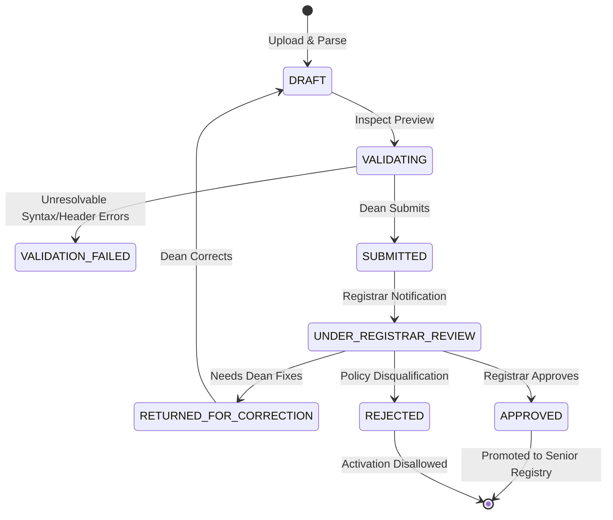

# Meri DBU Student: System Architecture

**Institution:** Debre Berhan University (DBU), Ethiopia  
**Repository:** https://github.com/ousmanseid/Meri-DBU-Student  
**Last Updated:** 2026-10-10  

---

## 1. High-Level Architectural Overview

Meri DBU Student is structured following clean-architecture principles, separating domain logic, data persistence, and interface delivery:

```mermaid
graph TD
    User([User / Browser]) <-->|HTTP/REST| WebUI[Frontend Web UI]
    WebUI <-->|JSON /api/v1| Router[Versioned API Router]
    
    subgraph Core Middlewares
        Router --> AuthMiddleware[RBAC & Scope Middleware]
        Router --> RateLimiter[Progressive Rate Limiter]
        Router --> ErrorHandler[Standardized Error Handler]
    end
    
    subgraph Service Layer
        AuthMiddleware --> AuthService[Authentication & Session Service]
        AuthMiddleware --> ActivationService[Freshman & Senior Activation]
        AuthMiddleware --> BatchImportService[Dean Batch Import Engine]
        AuthMiddleware --> RegistrarService[Registrar Review & Promotion]
        AuthMiddleware --> RagService[Access-Aware RAG Assistant]
        AuthMiddleware --> StudentService[Student Services & Inquiries]
        AuthMiddleware --> WorkflowService[University Approval Engine]
        AuthMiddleware --> AuditService[Immutable Audit Logger]
    end
    
    subgraph Database Layer
        AuthService --> DbAdapter[Database Adapter (Postgres / PGlite)]
        ActivationService --> DbAdapter
        BatchImportService --> DbAdapter
        RegistrarService --> DbAdapter
        RagService --> DbAdapter
        StudentService --> DbAdapter
        WorkflowService --> DbAdapter
        AuditService --> DbAdapter
        DbAdapter --> DB[(PostgreSQL Storage Engine)]
    end
```

---

## 2. Core Subsystems

### 2.1 Database Adapter Layer (`src/database/db.ts`)
Provides a unified interface (`query`, `transaction`, `close`) supporting:
- **Production PostgreSQL:** Configured via `DATABASE_URL` with connection pooling through `pg.Pool`.
- **Embedded PGlite Engine:** Lightweight WASM-compiled PostgreSQL engine storing data in `./data/pglite`. Allows zero-dependency execution for local development and rapid automated testing on Windows without external Docker services.

### 2.2 Security & Authorization Subsystem (`src/middleware/auth.middleware.ts`)
- **Deny-by-Default:** Endpoints require explicit authentication and role checks.
- **Hierarchical Roles:** 14 institutional roles scoped by institutional boundaries (College, Department).
- **Session Tokens:** Cryptographically random session tokens with database revocation on logout.

### 2.3 Senior Batch Processing State Machine (`src/services/batch-import.service.ts`)


### 2.4 Evidence-Grounded AI (RAG) Architecture (`src/services/rag.service.ts`)
- **Document Chunking:** Overlapping text chunks with section and document provenance metadata.
- **Dense Semantic Vector Engine:** 128-dimensional normalized dense vectors with cosine similarity ranking.
- **Access-Aware Security:** Automatically restricts retrieved knowledge chunks to the caller's authorized scope (`PUBLIC` visitors cannot retrieve `STAFF_ONLY` documents).
- **Responsible Abstention:** Returns an official disclaimer and refers the user to the Registrar Office if confidence falls below threshold.
