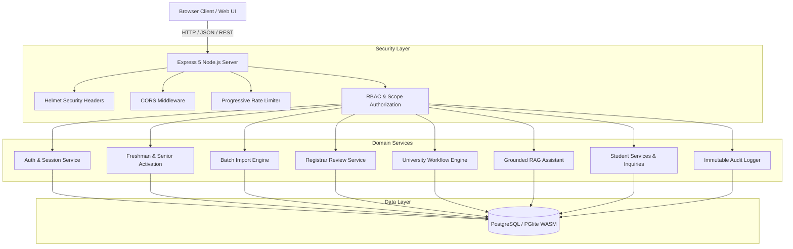
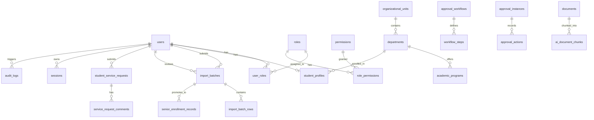

# Meri DBU Student: Architecture & Security Design

**Institution:** Debre Berhan University (DBU), Ethiopia  
**System Architecture & Threat Model Specification**  

---

## 1. System Architecture Diagram



---

## 2. Database Entity-Relationship Diagram (ERD)



---

## 3. RAG AI Assistant Architecture & Threat Modeling

```mermaid
graph LR
    Doc[Approved University PDF/Text] --> Chunker[Overlapping Chunker (400 chars, 80 overlap)]
    Chunker --> Embedder[Semantic Vector Generator]
    Embedder --> Index[(pgvector / ai_document_chunks)]
    
    UserQuery[User Query (English/Amharic)] --> Sanitizer[Prompt Injection Defense]
    Sanitizer --> QueryEmbedder[Query Vector Calculation]
    QueryEmbedder --> ScopeFilter[Access-Aware Role Filter]
    Index --> ScopeFilter
    ScopeFilter --> Ranker[Cosine Similarity + Keyword Boost]
    Ranker --> Decision{Similarity > Threshold?}
    
    Decision -- Yes --> Generator[Grounded Answer Generator + Citations]
    Decision -- No --> Abstain[Responsible Abstention Notice]
```

### Threat Mitigations

| Threat | Vulnerability | Mitigation Strategy |
| :--- | :--- | :--- |
| **Prompt Injection** | User attempts to override system prompt or exfiltrate passwords | Untrusted content boundaries, keyword sanitization, AI has zero DB write execution permissions. |
| **Confidential Leakage** | Staff senate minutes or private docs leaking to public chat | **Access-Aware Scope Filtering**: Query only searches chunks matching the caller's authorized role (`PUBLIC`, `STUDENT_ONLY`, `STAFF_ONLY`). |
| **Hallucination** | Fabricating deadlines or fees | If composite similarity score is under 0.22, AI strictly abstains and refers the student to the Registrar Office. |
| **Separation of Duties Bypass** | A Dean attempting to approve their own enrollment roster | Backend transaction strictly verifies `batch.submitting_user_id !== decision.reviewerUserId`. |
| **Privilege Escalation** | Client modifying student ID or role via profile endpoint | Server ignores user-controlled role fields; only administrators can alter role assignments via audited actions. |
