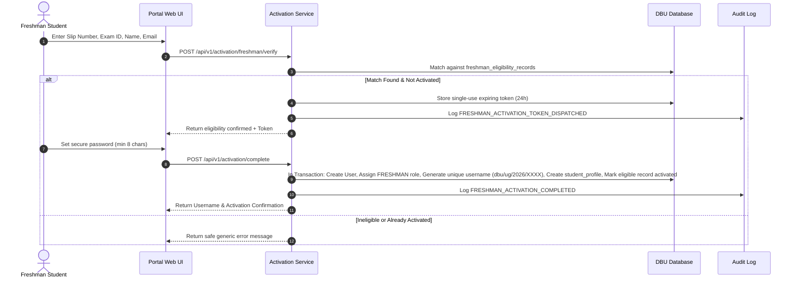
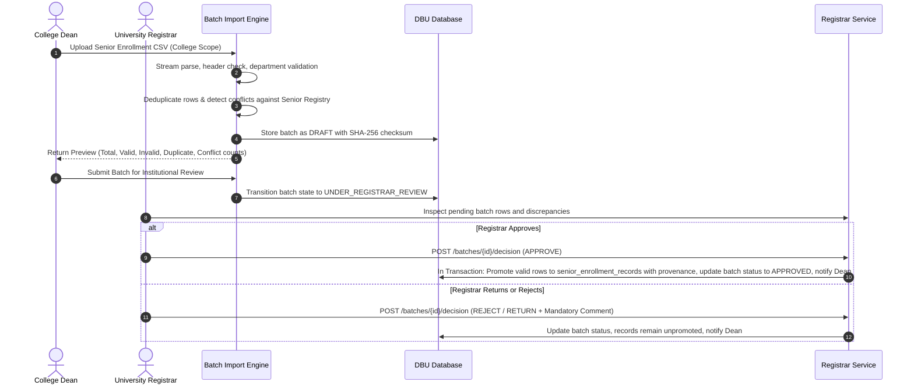

# Meri DBU Student: Software Requirements Specification (SRS)

**Institution:** Debre Berhan University (DBU), Ethiopia  
**System Name:** Meri DBU Student Platform  
**Document Version:** 1.0.0-PROD-READY  

---

## 1. Introduction

### 1.1 Purpose
Meri DBU Student is a centralized, role-based student information, academic verification, and student-support platform for Debre Berhan University (DBU), Ethiopia. This specification details all functional and non-functional requirements, business workflows, actor responsibilities, and system constraints.

### 1.2 System Scope
The platform complements official university student information systems (SIS) by handling:
- Public admissions guidance, notices, and academic calendars.
- Multi-factor freshman and senior student account activation.
- Senior-student batch imports with strict validation, deduplication, and Registrar institutional review.
- University administrative approval workflows conforming to Ethiopian higher-education practices.
- Student service inquiries and official record correction requests.
- Multi-lingual evidence-grounded AI knowledge retrieval (RAG) with source citations.

---

## 2. Actors & Responsibilities Matrix

| Actor | Responsibilities | Scope Restrictions |
| :--- | :--- | :--- |
| **Public Visitor** | Browses public notices, catalogs, academic calendar, and asks public AI assistant. | Denied access to private student dashboards or staff portals. |
| **Freshman Student** | Initiates activation with entrance slip & exam ID, verifies email, sets password, accesses student portal. | Cannot activate without matching authorized newly admitted list. |
| **Senior Student** | Activates account against Registrar-approved enrollment record, views academic profile, files service requests. | Cannot create or approve own enrollment record. |
| **College Dean** | Uploads senior student enrollment CSV/XLSX batches, inspects validation preview, submits to Registrar. | Restricted strictly to assigned College/Faculty. Cannot approve own batches. |
| **University Registrar** | Reviews submitted batches, inspects row-level discrepancies, approves or rejects with mandatory justification, manages official registry. | Separation of duties enforced. Submitter cannot approve. |
| **Admissions Officer** | Manages freshman admission eligibility rosters, verifies entrance exam records. | Scoped to freshman admissions. |
| **Student Affairs** | Receives, assigns, and resolves student service tickets (ID card, clearance, dormitories). | Scoped to assigned service categories. |
| **AI Knowledge Admin** | Ingests university policy documents, assigns access scopes, triggers indexing. | Cannot expose restricted staff docs to public scope. |
| **Compliance Auditor** | Read-only inspection of immutable system audit trails. | Cannot alter audit logs or modify student records. |
| **System Administrator** | Manages system settings, role assignments, operational platform health. | Least-privilege. No authority to alter academic decisions. |

---

## 3. Detailed Business Workflows

### 3.1 Freshman Account Activation Sequence

### 3.2 Senior Student Import & Registrar Approval Workflow

---

## 4. Non-Functional Requirements

- **Security**: Argon2id / Bcrypt 10-round password hashing, rate limiting on authentication routes, progressive lockout after 5 failed attempts, CSRF protection, secure HTTP headers via Helmet.
- **Data Integrity**: Database transactions for multi-step approval workflows and batch registry promotions. Foreign keys with RESTRICT/CASCADE rules prevent orphaned records.
- **Auditability**: All state-changing administrative actions recorded to append-only `audit_logs` table.
- **Availability & Portability**: Dual-mode database layer supporting production PostgreSQL and embedded PGlite for zero-dependency execution.
- **Usability & Accessibility**: Modern responsive layout tested on desktop, tablet, and mobile with WCAG contrast and bilingual English/Amharic UI elements.
